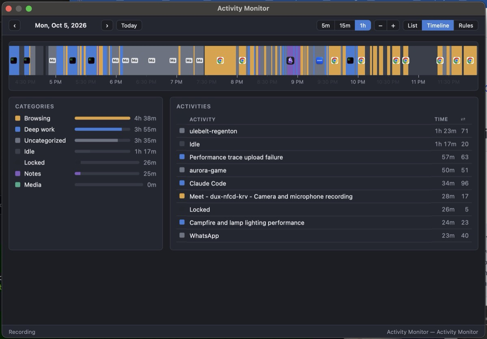

# Dayline

A small macOS menu-bar app that records which application and window you are actually looking at, and draws the day as a continuous colour-coded timeline.

It exists because the good time trackers are either expensive, cloud-hosted, or have a UI that makes the data hard to look at. This one keeps everything on your machine in a SQLite file, and puts the whole day on one strip you can scrub with the mouse.



## What it does

A sampler polls the frontmost application and its focused window title every 2 seconds and adds the elapsed time to a per-minute bucket. Two minutes without keyboard or mouse input counts as **Idle**, and a locked screen counts as **Locked**; both override application attribution, so time away from the machine is never billed to whatever was in front. In Safari and Chromium browsers it also reads the active tab's URL. Apps with a static window title can [report their own context](#reporting-context-from-your-app).

Everything you see is computed at read time from **rules** you control. A rule matches on application, window title and URL, and assigns a category plus a display label:

| Category | App | Title pattern | Label |
| --- | --- | --- | --- |
| Deep work | `^Code$` | `^.* — (.+)$` | `$1` |
| Browsing | `^Google Chrome$` | `^(.*?) - Google Chrome` | `$1` |
| Notes | `^Obsidian$` | `^(.*?) - .* - Obsidian` | `$1` |

The first matching rule wins. Because rules are applied when data is read rather than when it is written, editing one **retroactively reshapes every past day** -- you can decide six months from now that a project deserved its own category and the history will agree with you. The raw observations are never modified.

Click the date in the top bar to open a calendar and jump to any past day. Days are shaded by hours tracked, excluding Idle and Locked: dark gray means nothing was tracked, and shades of blue get brighter in 3-hour bands up to 12h or more.

Three views, chosen from the top right next to **Settings**:

- **Timeline** -- one slice per minute, coloured by category and stamped with the application's icon. Each minute shows whichever activity owned most of it, which throws away tab-flipping noise. Hover for the time, application, activity and category; drag across the strip to select a time range, which narrows the panels below to it. Click the strip to clear the selection.
- **List** -- one row per distinct activity, in the order you first touched it, with start time and total for the day.
- **Rules** -- the rule and category editors, next to a live table of raw observations so you can build a rule from something the sampler actually saw.

Right-click the menu-bar icon for **Reveal Data Folder** and **Quit**. While the dashboard window is open, Dayline also appears in the Dock and the system menu bar, so Cmd+Q quits it.

## Installing

Grab the `.zip` from the [latest release](../../releases/latest), unzip it, and drag `Dayline.app` into `/Applications`.

The app is **not notarized by Apple** -- notarization needs a paid Apple Developer account. macOS will therefore refuse to open it on the first try, saying it cannot verify the developer. To get past that:

1. Double-click `Dayline.app` and let macOS block it. Dismiss the dialog.
2. Open **System Settings → Privacy & Security** and scroll down to the Security section.
3. Click **Open Anyway** next to the line naming the app, and confirm.

That grants an exception for this copy. A version you download later arrives with its own quarantine flag, so it needs the same three steps again.

Then grant permission, or the window titles will all be blank:

1. Open **System Settings → Privacy & Security → Accessibility**.
2. Enable **Dayline**.

The app asks for this on first launch. It needs Accessibility because reading another application's window title is exactly what that permission gates. If you use Safari or a Chromium browser, macOS will separately ask for **Automation** permission the first time it reads a tab URL; declining only means browser rows are categorized by page title instead of URL.

To start it automatically at login, add it under **System Settings → General → Login Items**.

### Upgrading from Activity Monitor

This app used to be called Activity Monitor. Quit and delete the old app before opening Dayline, which moves your existing data and rules into its own folder on first launch. macOS treats Dayline as a new app, so the permission and Login Items steps above need doing again.

## Your data

Everything stays on your machine. There is no telemetry and no account, and the only network request the app can make is the optional, empty [health check](#getting-an-email-if-dayline-stops) ping.

```
~/Library/Application Support/Dayline/
  activity.sqlite3    every observation, append-only
  rules.json          your categories and rules
  settings.json       your health check URL, if you set one
  context/            what other apps report they are doing, if any
```

Window titles are recorded verbatim, so the database contains the names of documents, repositories, and web pages you had open. Treat it like a diary. Uninstalling the app does not delete it; remove that folder yourself if you want it gone.

The schema is one table and readable with any SQLite client:

```sh
sqlite3 ~/Library/Application\ Support/Dayline/activity.sqlite3 \
  "SELECT datetime(bucket_start,'unixepoch','localtime'), app_name, title, seconds
   FROM bucket_tally ORDER BY bucket_start DESC LIMIT 20;"
```

## Getting an email if Dayline stops

The sampler only records while the app runs, so a crash silently costs you every day until you notice. To hear about it sooner:

1. At [healthchecks.io](https://healthchecks.io/), create a check with a **Period** of 1 hour and a **Grace Time** of 1 day.
2. Copy its ping URL into the **Settings** tab and save.

Dayline pings on the next sample, which is how the tab can show straight away whether the URL works, then hourly while samples are being written to disk. A failed ping retries after 5 minutes. healthchecks.io emails you if about 25 hours pass without one.

Any https URL works, as long as a request to it counts as a check-in. The ping is an empty POST, but the monitor does see your IP address. Sleep stops the pings too, so a Mac left asleep for more than a day sends a false alarm that clears when it wakes.

## Reporting context from your app

An app whose window title never changes can tell the sampler what the user is doing by writing a JSON file named after its bundle id. There is no socket or server: the file is the whole API.

```
~/Library/Application Support/Dayline/context/dev.herdr.app.json
```

```json
{"title": "my-repo / fix login / claude", "url": "https://example.com/optional"}
```

`title` is required and must not be blank; `url` is optional.

- **Write atomically.** Write a temp file in the same folder, then rename it over the target, so the sampler never reads half a file. Create the folder if it doesn't exist.
- **Keep it fresh.** Rewrite the file when the context changes, and at least every 30 seconds while your app is frontmost. Only the file's modification time counts, so an unchanged rewrite still renews it.

While your app is frontmost and its file is under 60 seconds old, `title` and `url` replace the window title and URL. If the file is older or missing, the sampler goes back to the window title, so a client that dies can't keep crediting an old title. A malformed file is logged to Console.app and ignored the same way. Idle and Locked still win.

Reported values are stored and matched by rules exactly like window titles, so they get the same treatment in every view and in retroactive rule edits.

## Building from source

Requires macOS 13 or later and the Xcode **Command Line Tools** (`xcode-select --install`). Full Xcode is not needed.

```sh
bash scripts/make-signing-cert.sh   # once
bash scripts/build.sh
open build/Dayline.app
```

The certificate step is worth doing before anything else. macOS pins the Accessibility grant to the app's code signature, and an ad-hoc signature is just a hash of the bundle's contents -- so without a stable certificate, every rebuild looks like a brand new app and you re-approve the permission each time. The script creates a self-signed certificate in your login keychain; no Apple Developer account involved.

`scripts/build.sh` honours three environment variables: `AM_SIGN_IDENTITY` (certificate name, or `-` for ad-hoc), `AM_APP_DIR` (output directory), and `AM_UNIVERSAL=1` (build for both arm64 and x86_64).

`swift test` runs the tests.

To iterate on the dashboard without rebuilding, point the app at the source directory:

```sh
AM_RESOURCES="$PWD/Sources/Dayline/Resources" ./build/Dayline.app/Contents/MacOS/Dayline
```

### Layout

| File | What lives there |
| --- | --- |
| `Sampler.swift` | Polling, idle and lock detection, Accessibility and browser URL reads |
| `ContextFiles.swift` | Reads the context files apps write about themselves |
| `HealthCheck.swift` | The optional hourly ping and its setting |
| `Store.swift` | SQLite tally, schema migrations |
| `Rules.swift` | Rule matching and the shipped defaults |
| `AppDelegate.swift` | Status item, window, and the read-time aggregation the dashboard asks for |
| `Resources/dashboard.*` | The dashboard, plain HTML/CSS/JS in a WKWebView |
| `Resources/calendar.js` | Date, shading and range logic for the day picker and timeline, tested without a browser |
| `Resources/AppIcon.icns` | The app icon, regenerated by `swift scripts/make-icon.swift` |

## Cutting a release

One-time setup: install [`gh`](https://cli.github.com) (`brew install gh`) and log in (`gh auth login`). Tokens expire, so if a release stops at `gh is not logged in`, run `gh auth login` again.

The version lives in the `VERSION` file, so the repo always records what was last released. To release, bump `VERSION` (e.g. `0.2.0`), commit, push, then run:

```sh
bash scripts/release.sh
```

This publishes the current `main` commit as GitHub release `v0.2.0` with `Dayline-0.2.0.zip` attached. It stops with an error if you're not on `main`, if there are uncommitted changes, if `main` doesn't match `origin/main` (push first), or if that version is already released (bump `VERSION`). It then builds a universal (Apple Silicon + Intel) ad-hoc-signed app into `dist/`, zips it, shows a summary, and asks for confirmation. Only then does it create the tag and release on GitHub. Release notes are generated from the commits since the previous release. It never commits or pushes for you.

## Limitations

- Not notarized, so first launch needs the Gatekeeper dance above.
- No launch-at-login toggle in the app; use Login Items.
- The sampler stops when the app is not running. There is no backfill for time it missed.
- Idle threshold, poll interval and the 5-minute noise floor are constants in the source, not settings.
